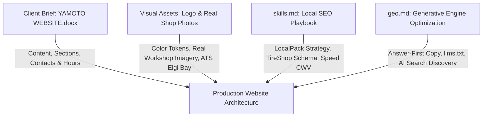

# Yamoto Tyre Care — Website Design & SEO/GEO Implementation Plan

> **Client:** Yamoto (Your Auto Mate / Reliable Marketing Services)  
> **Location:** Narsingi, Hyderabad, Telangana 500089 (Beside HPCL Petrol Station & Bajaj Electronics)  
> **Primary Source:** Client Brief (`YAMOTO WEBSITE.docx`)  
> **Strategy & Optimization Guides:** `skills.md` (Local SEO) & `geo.md` (AI Search / GEO)  
> **Tech Stack:** Semantic HTML5, Vanilla CSS3, Lightweight Vanilla JS (Zero external runtime dependencies, ultra-fast static performance)

---

## Executive Summary & Alignment of Sources

We evaluated the client specification (`YAMOTO WEBSITE.docx`), the real visual assets provided in the workspace (official logo, real workshop photos, brand logos), and the local SEO/GEO playbooks.



### Key Reconciliations
1. **Quote Box vs. Static Architecture:** The client brief specifies a 5-field quote box. Instead of needing a database or backend server, the quote form will run client-side JavaScript that validates input and opens WhatsApp with an organized, pre-formatted message sent directly to `+91 96760 65353`. If JavaScript is disabled, fallback direct call and WhatsApp buttons remain instantly clickable.
2. **Color Palette:** Derived directly from the official Yamoto logo and the illuminated showroom signage:
   - **Deep Midnight Navy (`#08142C` / `#0D1E42`):** Primary backgrounds, headers, and hero overlays.
   - **Dynamic Automotive Yellow (`#FDB913` / `#FFC400`):** Action buttons, highlight chips, offer badges, star ratings.
   - **Racing Red Accent (`#E52535`):** Subtle aerodynamic accents, urgency badges, and sale banners (matching the logo's red roofline).
   - **Clean White (`#FFFFFF`) & Slate Mist (`#F4F6FB`):** High-readability card surfaces and content areas.
3. **Real Photography:** We use the real workshop images provided in `images/` (ATS ELGI 3D wheel alignment system, Nitrogen filling station, illuminated night bay, and tyre racks) rather than generic third-party stock photos.
4. **NAP & Hours Consistency:**
   - **Address:** Narsingi, Hyderabad, Telangana 500089 (Beside HPCL Petrol Station & Bajaj Electronics).
   - **Shop Operating Hours:** Monday–Saturday: 10:00 AM – 9:00 PM | Sunday: 10:00 AM – 3:00 PM.
   - **Phone Support Hours:** Calls answered 8:00 AM – 8:00 PM on `+91 96528 07626`.
   - **WhatsApp Instant Bookings:** 24/7 reception on `+91 96760 65353`.
   - **Legal/Tax Entity:** Reliable Marketing Services (GSTIN: `36ABAFR5273R1ZI`).
   - **Social & Email:** Instagram `@yamoto.automate` | Email `yamoto.rms@gmail.com`.

---

# PART 1: Website Design & UI/UX Plan

## 1. Design System & Visual Hierarchy

### 1.1 Color Tokens
```css
:root {
  --navy-950: #050B17;       /* Darkest backdrop / mobile menu */
  --navy-900: #08142C;       /* Header, footer, hero backgrounds */
  --navy-800: #0F234C;       /* Card borders, dark section fills */
  --yellow-500: #FDB913;     /* Primary action CTA, star rating, badges */
  --yellow-400: #FFC933;     /* Hover state on CTAs */
  --red-600: #E52535;        /* Special offers, urgency tags, logo accent */
  --white: #FFFFFF;          /* Pure white card backgrounds & text on dark */
  --mist-100: #F3F6FB;       /* Alternate section background for high contrast */
  --gray-700: #334155;       /* Secondary body copy */
  --border-light: #E2E8F0;   /* Light dividers */
  --font-heading: 'Barlow', 'Inter', -apple-system, sans-serif;
  --font-body: 'Inter', -apple-system, sans-serif;
}
```

### 1.2 Layout & Aesthetics
- **Mechanical Precision & Workshop Authenticity:** Clean geometry, subtle carbon-fiber micro-textures or dark grid accents, with yellow automotive road-marking accents.
- **Mobile-First Priority:** Over 75% of local car tyre breakdowns and service searches happen on mobile phones.
  - Sticky mobile top header with quick Call and WhatsApp buttons.
  - **Sticky mobile bottom conversion bar** (3 quick taps: 📞 Call Now | 💬 WhatsApp Quote | 📍 Get Directions).
  - Minimum 48px touch targets for effortless one-thumb operation.

---

## 2. Page Structure & Section Breakdown (Home Page)

The home page directly implements the 8 sections requested in the client specification, enhanced with high-converting trust elements:

### Header & Sticky Navigation
- **Left:** Yamoto Logo (`website logo/Yamoto Logo.PNG`) with "YOUR AUTO MATE" lockup.
- **Center:** Quick links (`Services`, `Tyre Brands`, `Offers`, `Why Yamoto`, `Reviews`, `Location`).
- **Right:**
  - Status Indicator: Green pulsing badge `"Open Now • Closes 9:00 PM"` (dynamic JS calculation with static fallback).
  - Direct Phone Button: `tel:+919652807626` ("Call 96528 07626").
  - WhatsApp CTA Button: ("Chat on WhatsApp").

---

### Section I: Hero Dual Carousel / Hero Showcase
- **Hero Slide 1 (Service & Alignment Focus):**
  - **Visual:** Real hero photo of the ATS ELGI 3D wheel alignment system with technician and car in the service bay (`stock image 2.jpeg` / `images/shop image.jpeg`).
  - **Headline:** `Wheel Alignment & Tyre Care in Narsingi, Hyderabad`
  - **Subheadline:** `State-of-the-Art ATS ELGI 3D Alignment, Precision Balancing & Premium Tyres Beside HPCL Petrol Station.`
  - **CTA Button:** `Book Appointment` (Direct link to `tel:+919652807626`).
  - **Secondary CTA:** `Get a Free Quote` (Smooth scrolls down to Section II).
- **Hero Slide 2 (Offers & Tyre Replacement Focus):**
  - **Visual:** Showroom tyre racks with fresh MRF, Michelin & Bridgestone stock (`stock image 4.jpeg`).
  - **Headline:** `Swap Your Old Tyres and Save up to ₹1,000`
  - **Subheadline:** `Buy 4 new tyres and get up to ₹1,000 off + Free Tyre Rotation or Free Interior Cleaning!`
  - **CTA Button:** `Claim the Offer` (Smooth scrolls to Section II with promotional code pre-applied).

---

### Trust Banner (Immediately Below Hero)
A high-converting 4-column trust strip:
1. **ATS ELGI Certified Precision:** High-accuracy 3D digital camera alignment.
2. **Top Brands Stocked:** 100% genuine tyres with manufacturer warranty.
3. **Same-Day Fitting:** Ready bay with quick turnaround.
4. **4.9★ Customer Rating:** Verified Google reviews from Narsingi drivers.

---

### Section II: Request-for-Quotation Box ("Get a Free Quote")
- **Visual Design:** Floating high-contrast card with a subtle yellow border accent.
- **Fields (Exact to Client Specification):**
  1. `Full Name` (Text input)
  2. `Mobile Number` (10-digit Indian phone validation)
  3. `Car Make & Model` (e.g., Hyundai Creta, Maruti Swift, Kia Seltos, Tata Nexon)
  4. `Service Needed` (Dropdown: Wheel Alignment, Wheel Balancing, Tyre Rotation, New Tyre Replacement, Complete Tyre Health Check)
  5. `Preferred Visit Time` (Date & Time selector / Morning, Afternoon, Evening)
- **Interactive Action:**
  - On clicking `"Send Quote Request via WhatsApp"`: JavaScript constructs a pre-formatted message:
    > *"Hi Yamoto, I need a quotation:*  
    > *Name: [Name]*  
    > *Phone: [Mobile]*  
    > *Car: [Model]*  
    > *Service: [Service]*  
    > *Preferred Time: [Time]"*
  - Automatically launches WhatsApp Web or WhatsApp App to `+91 96760 65353`.
  - Fallback: Direct call and WhatsApp buttons displayed clearly underneath.

---

### Section III: Our Tyre & Wheel Services in Narsingi
Four prominent interactive service cards with clear pricing indicators ("from ₹") and real photos:
1. **3D Wheel Alignment:**
   - *Description:* High-precision alignment using ATS ELGI computerised 3D camera sensors to eliminate tyre pull and uneven wear.
   - *Feature Tag:* Free inspection with every multi-point check.
   - *Action:* "Book Alignment" (Opens RFQ with Wheel Alignment selected).
2. **Dynamic Wheel Balancing:**
   - *Description:* Eliminates high-speed steering vibration and premature suspension wear using digital wheel balancers.
   - *Feature Tag:* Precision alloy & steel wheel weights.
   - *Action:* "Book Balancing".
3. **Tyre Rotation & Nitrogen Fill:**
   - *Description:* Extends tyre tread life by up to 20% with scientific pattern rotation and high-purity NitroFill nitrogen.
   - *Feature Tag:* Free rotation with full alignment package.
   - *Action:* "Book Rotation".
4. **New Tyre Replacement:**
   - *Description:* Authorized sales and fitting of genuine tyres from 12" to 20"+ for hatchbacks, sedans, SUVs, and luxury vehicles.
   - *Feature Tag:* Old tyre exchange discount up to ₹1,000.
   - *Action:* "Explore Tyres".

---

### Section IV: Location & Facility Showcase ("Visit Yamoto in Narsingi")
- **Two-Column Split Layout:**
  - **Left Column (Facility Info):**
    - **Physical Address:** Narsingi, Hyderabad, Telangana 500089.
    - **Prominent Landmark:** *Beside HPCL Petrol Station & Bajaj Electronics (Narsingi Main Road).*
    - **Operating Hours Table:**
      - Monday – Saturday: `10:00 AM – 9:00 PM`
      - Sunday: `10:00 AM – 3:00 PM`
      - Phone Bookings: `8:00 AM – 8:00 PM`
    - **Direct Action Buttons:**
      - `📞 Call: +91 96528 07626`
      - `💬 WhatsApp: +91 96760 65353`
      - `📍 Get Directions on Google Maps`
  - **Right Column (Interactive Map & Street Guidance):**
    - Embedded responsive Google Map pinpointed on Narsingi.
    - Landmark thumbnail showcasing the adjacent HPCL petrol bunk entrance for effortless navigation.

---

### Section V: Why Drivers in Narsingi Trust Yamoto
Three feature pillars highlighting Yamoto's competitive edge:
1. **Value for Money:** Honest inspections, transparent price quotes, and no forced upselling or unnecessary parts replacement.
2. **Authorised Stockists of Top Brands:** Direct supply chains from India’s leading manufacturers ensuring authentic warranties and fresh manufacturing dates (DOT).
3. **ATS ELGI Precision Machinery:** Professional-grade workshop equipment engineered by ATS ELGI for zero-error wheel alignment and high-precision balancing.

---

### Section VI: Brand Panel ("Choose from India's Leading Tyre Brands")
- Interactive logo grid displaying all 9 brands with verified stock in Narsingi:
  1. **MRF**
  2. **Bridgestone**
  3. **Apollo**
  4. **JK Tyre**
  5. **Continental**
  6. **Michelin**
  7. **CEAT**
  8. **Yokohama**
  9. **Goodyear**
- Uses the authentic brand logos from `company logos/`.
- Interactive quick-filter chips allowing users to check sizes (e.g., `185/65 R15`, `205/55 R16`, `215/60 R16`, `235/65 R17`).

---

### Section VII: What Our Customers Say (Social Proof)
3 verified customer review cards tailored to popular local Hyderabad vehicles:
1. **Ravi K. (Hyundai Creta):**
   > *"Got my Creta aligned on their ATS Elgi machine after noticing highway pulling. Steering is dead straight now. Extremely professional team beside the HPCL bunk."* — ★★★★★
2. **Suresh Reddy (Maruti Swift):**
   > *"Replaced all 4 tyres with Apollo Amazer. Received the ₹1,000 exchange discount and complimentary tyre rotation. Honest pricing with zero hidden charges."* — ★★★★★
3. **Pooja Sharma (Kia Seltos):**
   > *"Super quick wheel balancing and nitrogen top-up. Great facility in Narsingi, open late till 9 PM which is super convenient after office hours."* — ★★★★★
- Link button: `"View All Reviews on Google (4.9★ Rating)"`.

---

### Section VIII: Workshop Gallery ("A Look Inside Yamoto") & Master Footer
- **Gallery Grid:** 6 to 9 high-resolution images showcasing the real workshop:
  1. Illuminated workshop front at night (`shop image.jpeg`).
  2. ATS ELGI 3D wheel alignment machine in action (`stock image 2.jpeg`).
  3. Customer driveway, nitrogen station & bay entry (`stock image 3.jpeg`).
  4. Storefront fascia board and workshop apron (`stock image 4.jpeg`).
  5. Close-up tyre rack displays with branded labels.
  6. Wheel balancing and precision rim clamp setup.
- **Comprehensive Master Footer:**
  - Business Identity: **Yamoto — Your Auto Mate** (Reliable Marketing Services, GSTIN: `36ABAFR5273R1ZI`).
  - Full NAP & Geo Coordinates.
  - Quick Links (Home, Services, Brands, Offers, FAQ, Contact, Privacy, Terms).
  - Social Links: Instagram (`@yamoto.automate`) & Email (`yamoto.rms@gmail.com`).
  - Copyright, developer credit, and self-hosted machine files (`llms.txt`, `pricing.md`, `sitemap.xml`).

---

# PART 2: Local SEO & Generative Engine Optimization (GEO) Plan

## 1. Local Search Engine Optimization (Google Local Pack)

The goal is to rank in the **Google 3-Pack** and top organic spots for local high-intent keywords across Narsingi, Kokapet, Gandipet, Manikonda, and Financial District.

### 1.1 Target Keywords Matrix
| Page / Section | Primary Keyword | Secondary Keywords | Search Intent |
|---|---|---|---|
| **Home Page** | `tyre shop in Narsingi` | `wheel alignment Narsingi`, `car tyres near me Narsingi`, `tyre shop Hyderabad` | Immediate Local Commercial |
| **Wheel Alignment** | `wheel alignment in Narsingi` | `3D wheel alignment Hyderabad`, `computerized wheel alignment Narsingi` | Urgent Technical Service |
| **Wheel Balancing** | `wheel balancing Narsingi` | `car wheel balancing Hyderabad`, `tyre balancing near me` | Preventative Service |
| **Tyre Replacement** | `new car tyres Narsingi` | `buy tyres Narsingi`, `MRF tyres Narsingi`, `Michelin tyres Hyderabad` | High Ticket Purchase |
| **Location / Contact** | `tyre shop near HPCL Narsingi` | `tyre puncture repair Narsingi open now`, `emergency tyre shop Narsingi` | Urgent Directional |

### 1.2 On-Page Meta & Heading Strategy
- **Homepage `<title>` Tag:**  
  `Tyre Shop in Narsingi | Wheel Alignment, Balancing & Tyres | Yamoto` (65 chars)
- **Homepage `<meta description>`:**  
  `Looking for a trusted tyre shop in Narsingi, Hyderabad? Yamoto offers ATS ELGI 3D wheel alignment, balancing & genuine tyres from MRF, Michelin & Apollo. Call +91 96528 07626.` (160 chars)
- **Single `<h1>` Tag:**  
  `Wheel Alignment & Tyre Care in Narsingi, Hyderabad`
- **Canonical URL:** Self-referential HTTPS canonical tag on every page.
- **Performance Targets:** Mobile LCP < 2.2s, CLS < 0.05, INP < 150ms (Passing Google Core Web Vitals on mobile).

### 1.3 Technical Schema.org Markup (JSON-LD)
We implement complete nested JSON-LD structured data:
- `@type: "TireShop"` with secondary `@type: "AutoRepair"`
- Business Name: `Yamoto - Your Auto Mate`
- Parent Organization: `Reliable Marketing Services`
- Full Address with Postal Code `500089` and Telangana State Code.
- GeoCoordinates for Narsingi (Lat: `17.3822`, Long: `78.3582`).
- Precise opening hours for weekdays and Sunday.
- Telephones: `+919652807626` and `+919676065353`.
- `sameAs` links pointing to Instagram, Google Business Profile, and directories.
- `hasOfferCatalog` listing Alignment, Balancing, Rotation, and Tyre Sales.
- `FAQPage` schema on the accordion Q&A section.

---

## 2. Generative Engine Optimization (GEO) for AI Search

AI assistants (ChatGPT Search, Perplexity, Google Gemini, Copilot, and Claude) extract facts using **extractable data structures, entity corroboration, and answer-first paragraphs**.

### 2.1 The "Answer-First" Content Pattern
Every service and FAQ section starts with an explicit, 45-word direct answer containing specific entities:
> **Example FAQ:**  
> *"Where can I get computerized wheel alignment in Narsingi?"*  
> **Direct Answer:**  
> *"Yamoto provides computerized 3D wheel alignment and balancing in Narsingi, Hyderabad, located beside the HPCL Petrol Station and Bajaj Electronics. Using ATS ELGI equipment, service starts from ₹350 and takes 30–45 minutes. Open Monday to Saturday until 9:00 PM."*

### 2.2 Machine-Readable Files (`/llms.txt` and `/pricing.md`)
We will create and deploy two static files at the root of the site:
1. **`/llms.txt`**: A structured markdown document providing search agents (Perplexity, ChatGPT, Claude) with an explicit summary of Yamoto's exact services, location landmarks, contact methods, operating hours, and brand offerings.
2. **`/pricing.md`**: A plain markdown table detailing transparent "from ₹" prices (3D Alignment, Balancing, Nitrogen Top-up, Rotation) to enable AI models to quote Yamoto accurately when users ask for pricing in Hyderabad.

### 2.3 AI Crawler Permissions in `robots.txt`
Configure `robots.txt` to explicitly permit AI search indexing bots (`OAI-SearchBot`, `ChatGPT-User`, `PerplexityBot`, `Claude-SearchBot`, `Applebot`), while pointing directly to `sitemap.xml` and `llms.txt`.

---

## 3. Google Business Profile & Off-Site Authority Plan

1. **GBP Profile Alignment:**
   - Primary Category: `Tire shop`
   - Secondary Categories: `Wheel alignment service`, `Car repair and maintenance service`
   - Name format: `Yamoto Tyre Care - Wheel Alignment & Tyres`
   - Website link with UTM tracking: `https://yamoto.in/?utm_source=gbp&utm_medium=organic`
2. **Real Photo Upload Cadence:** Upload 25+ real shop photos including the illuminated night view, ATS Elgi alignment bay, tyre stacks, and team at work.
3. **Local Citations:** Ensure 100% NAP consistency across Google Maps, Apple Business Connect, Bing Places, Justdial, Sulekha, and IndiaMART.

---

# PART 3: Project Architecture & Execution Steps

```
tyre-shop-website/
├── index.html                  # Full production Home page (Sections I to VIII)
├── css/
│   └── style.css               # Modern vanilla design system (Navy, Yellow, Red, White)
├── js/
│   └── main.js                 # Quote builder, WhatsApp handler, "Open Now" badge, modal/gallery
├── images/                     # Real showroom photos (shop image.jpeg, stock images 2-4)
├── company logos/              # 9 authentic tyre brand logos
├── website logo/               # Yamoto official logo
├── llms.txt                    # Machine-readable summary for AI engines
├── pricing.md                  # Transparent markdown pricing table for GEO
├── robots.txt                  # Search & AI bot crawler rules
└── sitemap.xml                 # XML sitemap with lastmod timestamps
```

### Next Action Step
Upon approval of this plan, we will immediately generate the complete, production-ready website (`index.html`, `css/style.css`, `js/main.js`, `llms.txt`, `pricing.md`, `robots.txt`, and `sitemap.xml`) integrating all real images and client details.
